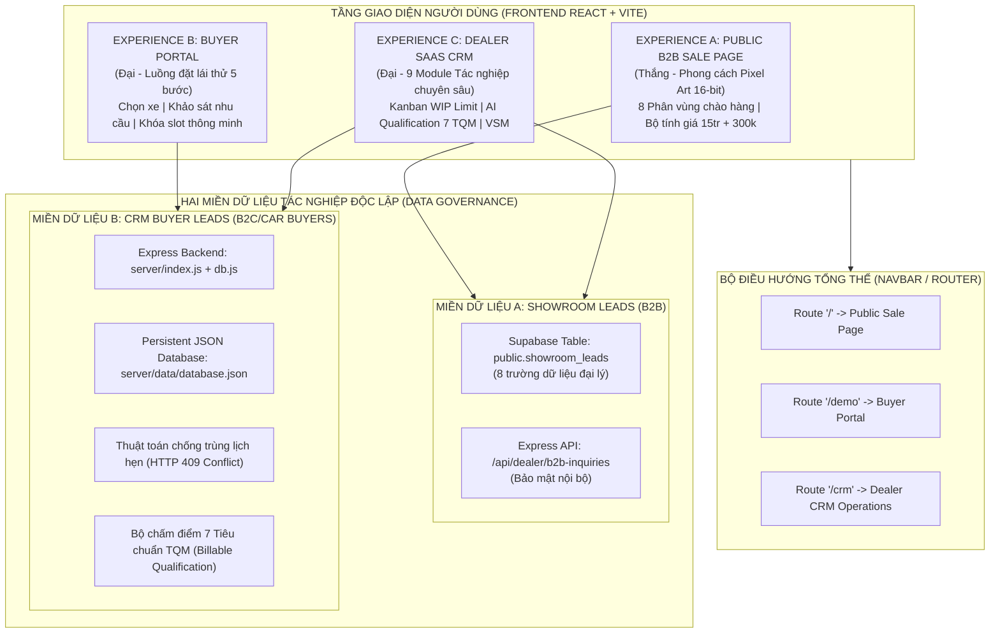

# AUTOLEAD SYSTEMS – MASTER INTEGRATED ARCHITECTURE
**Học phần**: Quản trị tác nghiệp Thương mại Điện tử (IUH)  
**Tiêu chuẩn kiến trúc**: Micro-Monolith, Dual Data Domains, Real-time Operations  

---

## 1. TỔNG QUAN KIẾN TRÚC TỔNG THỂ

Hệ thống **AutoLead Systems Integrated** được thiết kế bao bọc 3 tầng trải nghiệm người dùng thống nhất (Three-Tier User Journeys), giải quyết trọn vẹn cả yêu cầu của Chương 1 (MVP Vận hành) và Chương 3 (B2B Sale Page):



---

## 2. ĐẶC TẢ CHI TIẾT 3 PHÂN HỆ TRẢI NGHIỆM

### 2.1. Phân hệ A: Public B2B Sale Page (Thắng — Chương 3)
* **Ý tưởng thiết kế cốt lõi**: Pixel Art 16-bit – *The Automotive World* lấy cảm hứng từ nền tảng công nghệ tinh nhuệ của Cofounder.
* **Bảng màu nhận diện**:
  * Bầu trời xanh dither: `#4A98E8` / `#327FCB`
  * Cỏ xanh dither (Pixel Fringe): `#75A94C` / `#315C3C`
  * Nền trắng ấm: `#F8F9F5` / `#FFFFFF`
  * Xanh Navy đậm: `#142A43` / `#07182D`
  * Cam chuyển đổi chủ lực: `#F47721` (Hover: `#E76513`)
* **8 phân vùng nội dung bắt buộc**:
  1. `Hero`: Bầu trời 16-bit, showroom kính, siêu xe cam thương hiệu, 3 thẻ trạng thái AI lơ lửng, nút CTA "Đăng ký tư vấn 30 phút" & nút "Xem demo hệ thống".
  2. `Pixel Fringe & Ticker`: Dải phân tách dithered răng cưa pixel chuyển tiếp vào nội dung màu trắng ấm kèm các chỉ số đo lường hiệu quả tác nghiệp.
  3. `Problems`: 6 thách thức kinh doanh thực tế của showroom kèm ảnh `dealership-pixel-cars.jpg`.
  4. `Solutions`: 6 dịch vụ cốt lõi theo Lời chào hàng Offer.
  5. `Workflow`: Đường đua Pixel Art (Pixel Road Track) 5 chặng tác nghiệp kèm ảnh `dealership-sales-consultation.jpg`.
  6. `Pricing`: 15.000.000 VNĐ setup + 300.000 VNĐ/lịch hẹn, bộ tính toán ngân sách kéo thả Calculator Slider tức thì, ảnh `automotive-detail.jpg`.
  7. `Roadmap 30 ngày`: Lộ trình 4 giai đoạn chuẩn hóa quy trình dịch vụ.
  8. `Cam kết, FAQ & Form đăng ký`: Accordion 4 câu hỏi thường gặp, 3 cam kết vận hành và Biểu mẫu thu thập 8 trường dữ liệu B2B của showroom.

### 2.2. Phân hệ B: Buyer Portal (Đại — Chương 1)
* **Quy trình 5 bước tác nghiệp hoàn chỉnh**:
  * Bước 1: Chọn mẫu xe mong muốn (Mercedes C300, E300, GLC 300, Porsche Macan...).
  * Bước 2: Nhập thông tin người mua và xác thực SĐT di động Việt Nam (Regex 10 số).
  * Bước 3: Trả lời 4 câu hỏi định lượng nhu cầu (Mục đích, thời gian mua, tầm tài chính, sẵn sàng đến showroom).
  * Bước 4: Đặt lịch hẹn lái thử (Chọn ngày, khung giờ trống, khóa slot thời gian thực, ngăn chặn trùng lịch).
  * Bước 5: Xác nhận thành công và cấp Mã lịch hẹn (Appointment ID).
* **Cam kết kỹ thuật**: Lead và lịch hẹn tạo thành công phải lập tức được chuyển vào hàng đợi xử lý của CRM đại lý.

### 2.3. Phân hệ C: Dealer SaaS CRM & Operations Platform (Đại — Chương 1)
* **9 Module tác nghiệp chuyên sâu**:
  1. `DashboardOverview`: Đo lường chỉ số ROI, phễu I-T-O, Lead-time, cảnh báo tắc nghẽn WIP.
  2. `LeadManagement`: Bảng Kanban 6 giai đoạn tác nghiệp có kiểm soát Lean WIP Limit.
  3. `LeadQualification`: Ma trận 7 tiêu chuẩn chất lượng TQM.
  4. `AppointmentManagement`: Lịch công suất, phân bổ tư vấn viên, xử lý chuẩn xác mã lỗi HTTP 409 Conflict.
  5. `CampaignManagement`: Quản lý ngân sách và hiệu quả chiến dịch AI Ads.
  6. `AiAssistant`: Trợ lý AI gợi ý kịch bản phản hồi và chăm sóc khách hàng.
  7. `AnalyticsReporting`: Báo cáo dòng giá trị VSM và bảng kê chi phí CPA (300.000 VNĐ/cuộc hẹn).
  8. `B2BInquiriesViewer`: Quản lý danh sách các showroom đăng ký tư vấn từ Sale Page.
  9. `DealershipSettings`: Quản lý thông tin showroom và chức năng thiết lập lại dữ liệu mẫu an toàn.

---

## 3. THIẾT KẾ DỮ LIỆU & BẢO MẬT (DATA ARCHITECTURE & SECURITY)

### 3.1. Miền dữ liệu A – Showroom Inquiries (B2B)
Bảng Supabase: `public.showroom_leads`
```sql
CREATE TABLE IF NOT EXISTS public.showroom_leads (
    id UUID PRIMARY KEY DEFAULT gen_random_uuid(),
    contact_name TEXT NOT NULL,
    showroom_name TEXT NOT NULL,
    phone TEXT NOT NULL,
    email TEXT,
    showroom_type TEXT NOT NULL,
    consultation_need TEXT,
    showroom_location TEXT,
    monthly_lead_volume TEXT,
    consent BOOLEAN NOT NULL DEFAULT true,
    created_at TIMESTAMPTZ DEFAULT now()
);
```
Chính sách bảo mật: Người dùng công khai chỉ được cấp quyền `INSERT`. Quyền `SELECT` được bảo vệ chặt chẽ cho người quản trị / đại diện showroom đăng nhập hợp lệ.

### 3.2. Miền dữ liệu B – Customer Leads & Appointments (CRM)
Lưu trữ trên Express Backend (`server/data/database.json`) làm nguồn sự thật duy nhất (Single Source of Truth).
```json
{
  "cars": [],
  "leads": [],
  "appointments": [],
  "campaigns": [],
  "b2bInquiries": []
}
```
Lỗi xung đột lịch hẹn: Trả về HTTP 409 khi khách hàng chọn trùng xe và khung giờ đã được đặt trước. Frontend hiển thị cảnh báo rõ ràng thay vì âm thầm lưu vào LocalStorage.
