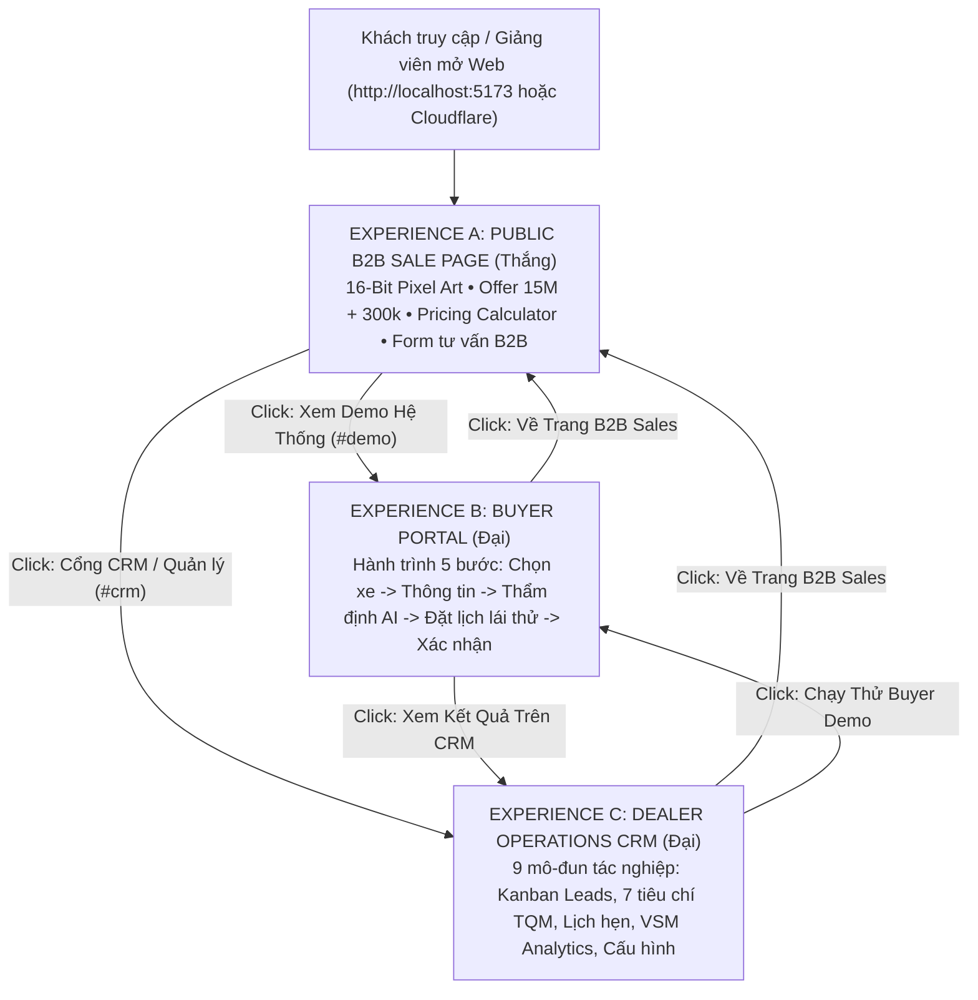

# MA TRẬN TÍNH NĂNG (FEATURE MATRIX)
## So sánh: Dự án A (Đại) vs. Dự án B (Thắng) vs. Hệ thống Hợp nhất (Master Integrated)

**Học phần:** Quản trị tác nghiệp Thương mại điện tử  
**Mục tiêu:** Chứng minh toàn bộ đóng góp chuyên môn của cả 2 thành viên đều được kế thừa và vận hành hoàn hảo trong sản phẩm cuối cùng.

---

## 1. BẢNG SO SÁNH TỔNG THỂ

| Nhóm chức năng | Dự án A (Đại) `autolead-systems-project` | Dự án B (Thắng) `autolead-systems` | Hệ thống Hợp nhất (Master) `autolead-systems-integrated` | Ghi chú & Đóng góp |
|----------------|:------------------------------------------:|:------------------------------------:|:----------------------------------------------------------:|-------------------|
| **Phong cách thiết kế** | Dark Luxury Theme (#C7A66A Gold) | 16-Bit Pixel Art (#4A98E8, #75A94C) | **16-Bit Pixel Art** + Dark CRM chuyên nghiệp | Kế thừa nhận diện 16-bit độc đáo của Thắng cho toàn bộ trang Public |
| **Pixel Art Visual Assets** | ❌ Không có | ✅ 4 ảnh Pixel Art chất lượng cao | ✅ **Đầy đủ 4 ảnh Pixel Art** (Showroom, Cars, Consultation, Detail) | Trích xuất và bảo toàn toàn bộ tài nguyên hình ảnh của Thắng |
| **Pixel SVG Custom Icons** | ❌ Chỉ dùng Lucide icons | ✅ Bộ 10 icon Pixel SVG 16-bit | ✅ **Tích hợp trọn bộ 10 icon Pixel SVG** | Trích xuất từ bundle gốc của Thắng sang `PixelIcons.jsx` |
| **Đường viền Pixel Fringe** | ❌ Không có | ✅ Pattern dither chuyển màu cỏ | ✅ **Component `PixelFringe.jsx` chuẩn hóa** | Tạo nét đặc trưng giao diện 16-bit giữa các phân đoạn |
| **Trang đích mặc định** | Cổng BuyerDemo / CRM | B2B Sales Landing Page | ✅ **B2B Sales Page (Experience A)** | Đáp ứng đúng chuẩn: B2B Sale Page là cửa ngõ chính của hệ thống |
| **8 Section B2B Landing** | ⚠️ Một số section bị lỗi font | ✅ Đầy đủ 8 section 16-bit | ✅ **Đầy đủ 8 section chuẩn hóa tiếng Việt UTF-8** | Kế thừa toàn bộ nội dung và layout bản Offer B2B của Thắng |
| **Thanh trượt Calculator** | ❌ Tĩnh, không tương tác | ✅ Thanh trượt live 10-100 cuộc hẹn | ✅ **Thanh trượt Calculator live tương tác** | Tính toán minh bạch công thức: $15M + N \times 300k$ |
| **Form tư vấn B2B** | ⚠️ Đơn giản, lưu LocalStorage | ✅ 8 trường, kết nối Supabase | ✅ **Đầy đủ 8 trường + 2 trường bổ sung + Supabase Fallback** | Tự động fallback sang Express server và LocalStorage an toàn |
| **Quản lý Lead B2B (Domain A)** | ⚠️ Chưa tách biệt rõ ràng | ✅ Modal xem `showroom_leads` | ✅ **Modal `B2BInquiriesModal` + Tab CRM chuyên biệt** | Phân tách miền dữ liệu hoàn toàn độc lập với lead mua xe |
| **Buyer Portal (5 bước)** | ✅ Đầy đủ 5 bước hoàn chỉnh | ⚠️ Chỉ có bản demo nhúng | ✅ **Bảo tồn nguyên vẹn 5 bước của bạn Đại** | Giữ nguyên danh mục xe sang, questionnaire và booking engine |
| **Chống trùng lịch (Bug 5)** | ⚠️ Bị nuốt lỗi 409 vào local | ❌ Chưa có backend conflict | ✅ **HTTP 409 Conflict Handling hoàn hảo** | Báo lỗi tiếng Việt trên UI, không lưu trùng lịch vào DB |
| **TQM 7-Criterion Gating** | ✅ Có khung 7 tiêu chí | ❌ Chưa có trong Sale Page | ✅ **Kiểm soát chặt chẽ 7/7 tiêu chí mới tính phí 300k** | Đảm bảo tính minh bạch theo đúng chuẩn bài báo cáo GK |
| **Dealer CRM 9 mô-đun** | ✅ Đầy đủ 9 mô-đun nghiệp vụ | ❌ Không có | ✅ **Giữ nguyên 100% 9 mô-đun CRM của bạn Đại** | Kanban, AI Assistant, VSM Analytics, Appointment Management |
| **Xác thực đại lý (Bug 10)** | ⚠️ Dễ dãi (toán tử `\|\|`) | ❌ Không có phần backend | ✅ **Xác thực đăng nhập nghiêm ngặt** | Phân quyền 4 tài khoản: Dealer, Admin, Đại, Thắng |
| **Express Full-Stack Server** | ✅ Có Express backend | ❌ Chỉ có Vite frontend tĩnh | ✅ **Full-stack Express + SPA static delivery** | Chạy độc lập trên cổng 5173, hỗ trợ cả API lẫn giao diện web |
| **Cloudflare Tunnel** | ⚠️ Chưa cấu hình batch tự động | ⚠️ Tách rời | ✅ **Có sẵn 2 script batch `chay_web.bat` & Cloudflare** | Người dùng hoặc giảng viên chỉ cần click đúp là chạy ngay |

---

## 2. MA TRẬN 3 TRẢI NGHIỆM NGƯỜI DÙNG (USER EXPERIENCES)

---

## 3. PHÂN ĐỊNH TRÁCH NHIỆM & ĐÓNG GÓP HỌC THUẬT

### Thành viên: Trần Quang Đại (Phần 1.2)
- **Tài liệu học thuật:** `docs/1.2_Thiet_Ke_Va_Phat_Trien_MVP_Dai.docx`
- **Các thành phần chịu trách nhiệm chính:**
  - Quy trình trải nghiệm khách hàng mua xe (Buyer Portal).
  - Thuật toán tính điểm AI Lead Qualification.
  - Cơ chế lập lịch lái thử chống xung đột (Conflict-Free Booking).
  - Nền tảng Express REST API & Database JSON lưu trữ trạng thái.
  - Hệ thống CRM 9 mô-đun và công cụ phân tích hiệu suất tác nghiệp VSM.

### Thành viên: Nguyễn Việt Thắng (Phần 3.3 & 3.4)
- **Tài liệu học thuật:** `docs/3.3_3.4_Bao_cao_SalePage_Thang.docx`
- **Các thành phần chịu trách nhiệm chính:**
  - Bộ nhận diện thương hiệu độc quyền 16-bit Pixel Art – The Automotive World.
  - Xây dựng 8 phân đoạn B2B Sales Landing Page.
  - Thiết kế công cụ tính toán ngân sách và tỷ suất hoàn vốn (Pricing Calculator Slider).
  - Form thu thập thông tin đối tác Showroom và lưu trữ Supabase Table `showroom_leads`.
  - Bộ kịch bản và kế hoạch kiểm thử chất lượng hệ thống (Quality Assurance & Testing).

---

## 4. KẾT LUẬN

Bản build hợp nhất `autolead-systems-integrated` thể hiện sự kết hợp hài hòa, nâng tầm cả hai đồ án thành viên thành một giải pháp phần mềm thương mại điện tử ô tô toàn diện, sẵn sàng trình bày trước hội đồng đánh giá.
